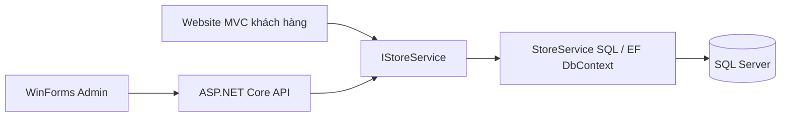

# Kiến trúc triển khai

## Các thành phần thực tế

- PhoneStore.Core: DTO, IStoreService, nhãn/trạng thái và mô hình Stock/Order độc lập giao diện.
- PhoneStore.Infrastructure: ánh xạ EF Core SQL Server, migration SQL phiên bản, dữ liệu seed và triển khai IStoreService theo nhóm Auth/CatalogCart/Order/Admin.
- PhoneStore.Web: composition root, MVC khách hàng và API. Controller lấy actor từ phiên, gọi IStoreService; View Razor không truy cập SQL.
- PhoneStore.Admin: ứng dụng WinForms, gọi HTTP API qua HttpClient/CookieContainer, tự lấy CSRF token cho mỗi lệnh ghi, không chứa chuỗi kết nối SQL.
- PhoneStore.Checks: kiểm tra miền, tích hợp SQL nhiều kết nối và nghiệm thu HTTP/MVC.

MVC và API cùng host, dùng cùng dịch vụ trong tiến trình. Đây là triển khai hợp lý cho một cửa hàng, tránh website tự gọi vòng HTTP vào chính nó. WinForms luôn đi qua API. EF DbContext hiện đóng vai repository và unit of work; không nhân đôi bằng các repository interface nhỏ. IStoreService là hợp đồng trừu tượng ở Core. Cách đóng gói này là lựa chọn triển khai so với các interface IOrderRepository/IUnitOfWork minh họa trong tài liệu.

## Model, dữ liệu và giao dịch

16 bảng nghiệp vụ giữ tên không dấu theo tài liệu; tên cột dùng tiếng Anh tương ứng DTO. Bảng PHIEN bổ sung để thu hồi phiên tức thì. Khóa ngoại NO ACTION, mã/SKU/username/email/SĐT duy nhất, unique biến thể theo sản phẩm/màu/dung lượng, kiểm tra số dư, số lượng và giá dương. Biến thể, kho, đơn và phiếu có SQL rowversion theo thiết kế. Tổng tiền decimal(18,2), thời gian UTC; bộ lọc ngày đổi UTC+7 với đầu kỳ đóng/cuối kỳ mở.

Stock/Order ở Core mô tả bất biến miền và được kiểm tra độc lập. Các lệnh SQL thực tế kiểm tra lại bất biến trong StoreService; không dựa vào trạng thái trong RAM để bảo vệ đồng thời. Không có adapter dữ liệu giả trong DI/runtime.

Mọi lệnh ghi đi qua Atomic: transaction Serializable, khóa ứng dụng `PhoneStore:write` sở hữu bởi transaction. Khóa này đồng bộ cả nhiều tiến trình/API host trên cùng DB. Sau đó thực hiện SQL có điều kiện, ghi chứng từ/thanh toán/lịch sử/nhật ký rồi commit toàn bộ. EF concurrency và lỗi SQL hoàn tác giao dịch. Các biến thể được xử lý theo ID tăng dần. Cách khóa toàn bộ writer ưu tiên tính đúng cho quy mô cửa hàng; chưa đánh giá thông lượng lớn, có thể thay bằng khóa hẹp sau khi đo.

- Giỏ không giữ kho; checkout so giá/số lượng vừa được khách xác nhận với DB rồi giữ bằng `UPDATE ... WHERE OnHand - Reserved >= q`. Một dòng thất bại rollback cả đơn.
- RequestKey duy nhất trả lại đơn cũ chỉ cho đúng chủ sở hữu.
- Lệnh chuyển trạng thái kiểm tra rowversion trước ghi. Giao giảm cả tồn và giữ; hủy trước giao chỉ giảm giữ.
- Giao thất bại chưa nhập lại; nhận lại toàn bộ một lần được chặn thêm bằng unique nhật ký `(OrderId, VariantId, Kind)`.
- Xác nhận phiếu chỉ từ NHAP; nhiều dòng, tổng và kho cùng transaction. Sau xác nhận không sửa phiếu/dòng.
- OperationKey và VariantId duy nhất cho nhật ký. Retry không làm kho thay đổi thêm; các thao tác đã chốt trả lỗi thay vì tạo tác dụng lần nữa.
- Kiểm kê nhập số tồn thực tế và lý do; server tính chênh lệch, kiểm tra tồn >= giữ rồi ghi nhật ký.

Sửa sản phẩm bắt buộc gửi đủ biến thể cũ; ngừng bán thay xóa. Khi lưu sản phẩm, rowversion các biến thể được cập nhật ngay cả khi chỉ thay thông tin chung để phát hiện form cũ ghi đè.

## Xác thực và bảo vệ dữ liệu

PasswordHasher của ASP.NET Core dùng hash có salt. Tài khoản được chuẩn hóa về chữ thường; đăng ký chỉ tạo CUSTOMER. Đăng nhập Admin kiểm tra vai trò riêng. Cookie HttpOnly/SameSite Lax, phiên giới hạn 8 giờ, mỗi request kiểm tra PHIEN + tài khoản hoạt động. Logout xóa phiên hiện hành; đổi mật khẩu hoặc khóa khách xóa tất cả phiên. Hành vi này đã được kiểm tra với cookie cũ.

API/MVC đều kiểm tra CSRF cho lệnh ghi; WinForms lấy token từ `/api/security/token`. Tài khoản/actor không bind từ request. Dịch vụ kiểm tra lại vai trò và trạng thái account khi xử lý. DTO không có hash/mật khẩu hoặc quyền sửa tùy ý. Sai quyền trả 401/403; ID đơn không thuộc khách trả 404. Lỗi nghiệp vụ có mã và thông báo tiếng Việt; lỗi ngoài dự kiến chỉ trả thông báo chung và mã tra cứu, chi tiết nằm log server.

## Báo cáo và giao diện

Doanh thu/bán chạy lấy đúng tập đơn HOAN_TAT + DA_THU theo CompletedAt. ReportResult được dùng nguyên vẹn cho cả bảng và biểu đồ WinForms. Tồn báo cáo có cả OnHand/Reserved/Available, biểu đồ là Available; không áp dụng khoảng ngày. Tổng quan có doanh thu kỳ và hôm nay, đơn chờ, hàng sắp hết; nút dẫn sang danh sách đã lọc.

Website Razor responsive, HTML encode dữ liệu, trạng thái tải/chống gửi lặp, giỏ guest localStorage và hợp nhất có transaction. Các form tài khoản/checkout giữ dữ liệu khi lỗi. WinForms có các trang danh sách phân trang/tìm kiếm, form nhiều biến thể, phiếu nháp nhiều dòng, lệnh theo trạng thái đơn, xác nhận thao tác nhạy cảm và PrintPreview hóa đơn snapshot.

Ảnh seed là SVG minh họa tĩnh; trường ảnh sản phẩm lưu và sửa trong CSDL bằng URL HTTPS hoặc đường dẫn /images/. Đây là tài sản giao diện, không thay thế dữ liệu nghiệp vụ.

## Vận hành và phạm vi

Migration SQL có sổ phiên bản/SHA-256 và khóa khi áp dụng; không chạy tự động khi mở server. BackupRestore.ps1 dùng COPY_ONLY/CHECKSUM, VERIFYONLY, restore vào DB mới và từ chối ghi đè. Chưa có lịch backup tự động, benchmark tải hay triển khai production. Các phần ngoài phạm vi tài liệu vẫn được giữ ngoài: khuyến mãi, IMEI, thuế điện tử, hoàn trả từng phần, tích hợp giao vận/thanh toán online.

## Launcher Windows và cấu hình triển khai

WinForms đọc AdminSettings từ LocalAppData thay vì lấy URL trực tiếp ở form đăng nhập. BackendLauncher xác minh health application/environment/fingerprint server-CSDL trước đăng nhập; Local dùng executable publish, Remote chỉ kết nối HTTPS đã cấu hình. Mutex giới hạn một cửa sổ Admin và semaphore theo URL bảo vệ cold start giữa các process. Backend local là backend chung với website, sống qua các lần đóng/mở Admin; không seed/migrate/reset trong launcher.

Health `/health/ready` truy vấn schema read-only, trả200/503 với fingerprint không chứa connection string. QA vẫn có guard server/database và endpoint identity riêng. Thông tin SQL local được chuẩn bị ngoài release trong LocalAppData; không đóng gói credential QA. Chi tiết trong ADMIN_WINDOWS.md và qa/ADMIN_PACKAGING_REPORT.md.

## Website cập nhật và query công khai

HomeController gọi BestSellers cùng RevenueOrders/Bounds của báo cáo; không gọi API Admin từ trình duyệt. Catalog/Search dùng cùng service và view; suggestions truy vấn SQL bounded, empty trả ngay; Color áp dụng chung với các điều kiện biến thể trong Any, min/sort và public DTO.

ProductQuery dùng split query để load ảnh/biến thể theo batch. Migration002 chỉ bổ sung bảng SAN_PHAM_ANH (Url HTTPS qua validation, SortOrder, FK, index), giữ Product.ImageUrl làm cover. ProductInput.Images=null bảo toàn gallery cho client cũ. PublicProductDto chỉ trả Available, không trả OnHand/Reserved/Version. CheckoutRequest thêm PaymentMethod mặc định COD; mọi giá trị khác bị chặn trước khi tạo đơn/giữ hàng. QR chưa tích hợp ngân hàng.

Backend QA website publish mới dùng cùng SQL/cổng65377 và được launcher Admin dùng lại; không tự migration/seed khi mở. Bằng chứng và các giới hạn: qa/WEB_DISCOVERY_REPORT.md.
